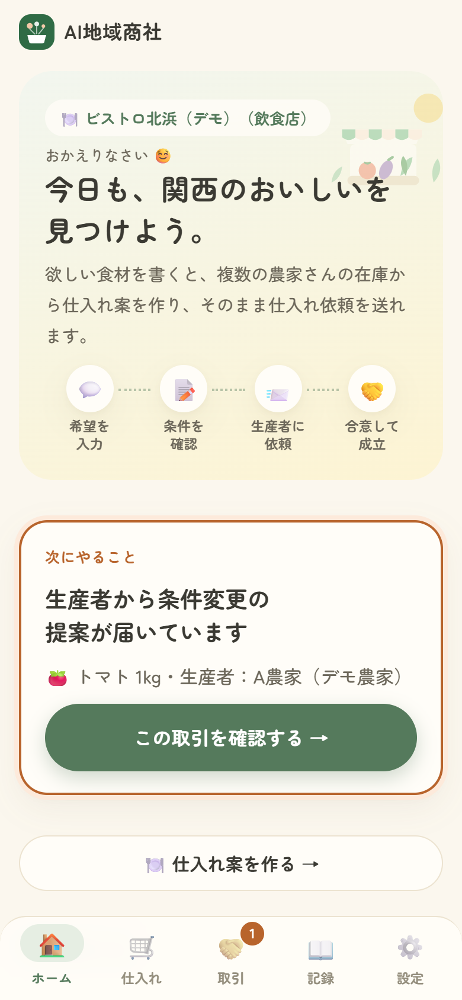
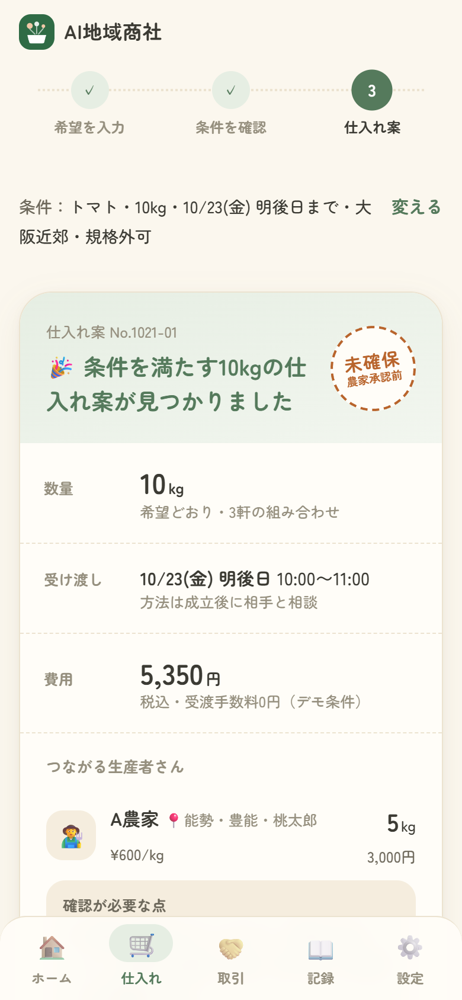
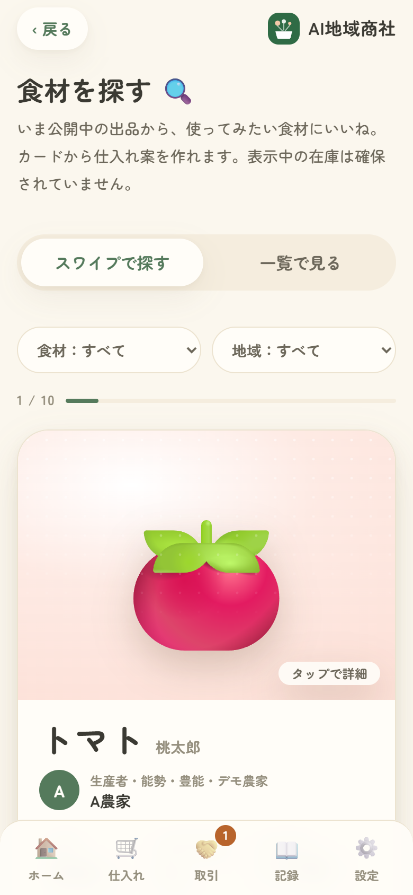
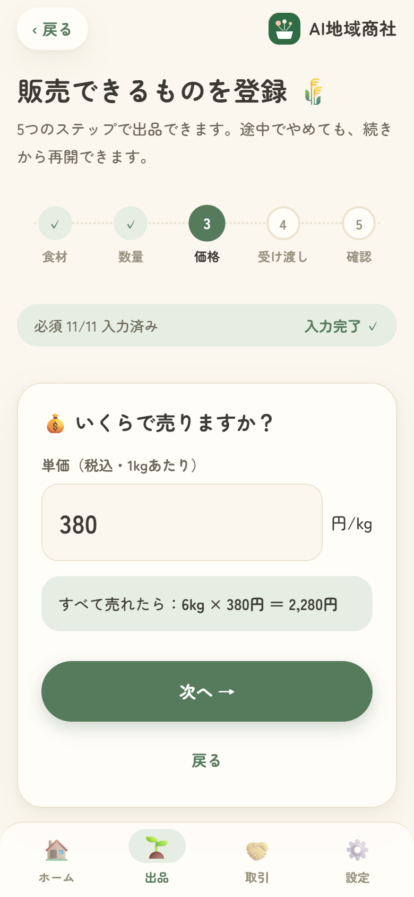
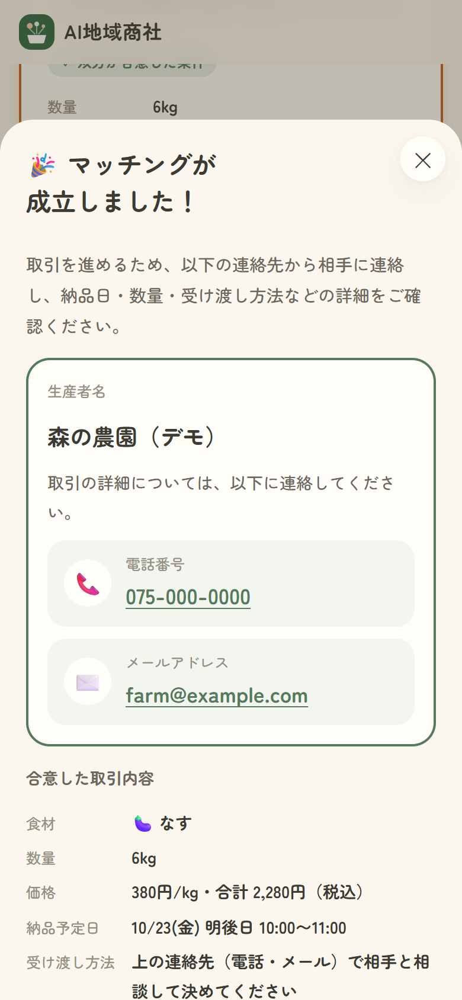

# AI地域商社

**飲食店が「欲しい食材」を文章で書くだけで、複数の生産者の出品を組み合わせた仕入れ案を作り、そのまま仕入れ依頼から取引完了までを進められるWebアプリ（MVP）。**

関西の小規模な生産者と飲食店をつなぐことを想定しています。1軒の農家では量が足りない注文も、複数の農家の「販売に回せる量」を組み合わせて1つの仕入れ案にします。

| | |
| --- | --- |
| 公開アプリ | https://ai-chiiki-shosha.vercel.app |
| リポジトリ | https://github.com/sakikanemoto-ctrl/ai-chiiki-shosha |
| 状態 | MVP（デモ用）。表示中の「A農家」などのデモ農家・在庫・価格はすべて架空です |

## 目次

1. [スクリーンショット](#スクリーンショット)
2. [解決したい課題](#解決したい課題)
3. [特徴・独自性](#特徴独自性)
4. [飲食店側の機能](#飲食店側の機能)
5. [生産者側の機能](#生産者側の機能)
6. [マッチングから取引完了までの流れ](#マッチングから取引完了までの流れ)
7. [AIの担当と、通常のプログラムの担当](#aiの担当と通常のプログラムの担当)
8. [技術構成](#技術構成)
9. [データの保存方法](#データの保存方法)
10. [セキュリティと権限管理](#セキュリティと権限管理)
11. [動作確認の手順](#動作確認の手順)
12. [ローカル環境での起動方法](#ローカル環境での起動方法)
13. [Vercelへの公開方法](#vercelへの公開方法)
14. [未実装・既知の制限](#未実装既知の制限)
15. [今後の改善候補](#今後の改善候補)

## スクリーンショット

スマートフォン幅で撮影しています。写っている店名・農家名・電話番号・メールアドレスは、撮影用の架空のデータです。

| ホーム（飲食店） | AI仕入れ提案 | 食材のカード表示 |
| :---: | :---: | :---: |
|  |  |  |
| 「次にやること」を最上部に表示 | 複数の農家の出品を組み合わせた仕入れ案 | スワイプで食材を探す |

| 生産者の食材登録 | マッチング成立後 |
| :---: | :---: |
|  |  |
| 5ステップで出品（価格の入力） | 相手の連絡先と合意した取引内容 |

## 解決したい課題

- 小規模な生産者は、1軒あたりの出荷量が少なく、飲食店がまとまった量を仕入れたいときに1軒だけでは足りないことがある
- 規格外品や余剰品など「販売に回せる量」があっても、飲食店に届ける手段が限られている
- 飲食店が複数の農家に個別に在庫・価格・受け渡し日を確認し、組み合わせを考えるのは手間がかかる

このアプリは、分散した小さな供給を、飲食店が使える1つの仕入れ案にまとめることを目指しています（効果を測定したデータはまだありません）。

## 特徴・独自性

| 特徴 | 内容 |
| --- | --- |
| **文章から仕入れ案まで** | 「明後日までに大阪近郊のトマトを10kg、多少形が悪くてもOK」と書くだけで、AIが条件を項目に整理し、条件に合う出品を組み合わせた仕入れ案を作る |
| **複数の生産者の組み合わせ** | 1軒で足りなければ、同じ受け渡し日時の出品を組み合わせる。仕入れ先が少ない → 合計金額が安い順に選ぶ |
| **足りないときも理由を示す** | 「2kg不足」「同じ日時で受け取れる組み合わせがない」「販売刻みの都合でちょうどにできない」を区別し、条件を変えれば成立する案（規格外も含める・地域や価格の指定を外す・日付を変える など）を示す。数量を勝手に丸めない |
| **規格外・余剰も生かす** | 生産者は規格外の理由や余剰品であることを登録でき、飲食店は規格外を含めるかを選べる。仕入れ案の食材から、一般的な料理例と原価の目安を出す「限定メニュー案」もある |
| **AIと計算の役割分担** | AIは文章の読み取りとメニュー名・紹介文づくりだけ。誰から何kg仕入れるかは通常のプログラムで計算するので、AIが在庫や価格を作り出すことはない |
| **合意まで成立にしない** | 依頼・条件変更の提案だけでは成立せず、数量・単価・受け渡し日・時間に双方が同じ内容で同意したときだけ「マッチング成立」になる |

## 飲食店側の機能

| 機能 | 内容 |
| --- | --- |
| 仕入れ案を作る | 希望を文章で入力 →「AIで条件を整理する」→ 条件を確認・修正 → 仕入れ案。AIを使わずに項目を選んで入力することもできる |
| 食材を探す | 公開中の出品をカードで1枚ずつ見て、右にスワイプ（またはハート）でいいね、左でスキップ。食材・地域で絞り込み。「一覧で見る」にも切り替えられる。カードから、その出品の条件を入れた仕入れ案を作れる |
| 仕入れ依頼を送る | 仕入れ案の「この案で生産者に仕入れ依頼を送る」から、生産者ごとに依頼を送る。同じ案から二重に依頼は作られない |
| 回答・取引を確認する | 生産者からの回答（受ける・断る・条件変更の提案）を確認し、条件変更には同意するか出し直す。成立後は「取引成立・連絡先を確認」で相手の連絡先を見て、受け渡しが済んだら「取引完了」 |
| 在庫の変化に追従 | 在庫や公開状態が変わると、古い仕入れ案を「使えない」と表示し、今の在庫で計算し直す（15秒ごとに確認） |
| 限定メニュー案 | 仕入れ案の食材から、一般的な料理例・必要量の目安・原価の目安を表示。APIキーがあればAIがメニュー名・紹介文を考える |
| 記録 | 仕入れ案を保存して、あとで見直せる（保存しただけでは依頼は送られない）。開くたびに今の在庫で計算し直す |

## 生産者側の機能

| 機能 | 内容 |
| --- | --- |
| 販売できるものを登録 | 食材（品目・品種・産地・規格外の理由・余剰）→ 数量（販売可能量・単位・最低販売量・販売刻み）→ 価格 → 受け渡し日時 → 確認 の5ステップ。飲食店からの見え方をプレビューできる。前回の出品条件を読み込む |
| 出品を管理する | 自分の出品の数量・出荷日・公開状態の変更、編集、削除 |
| 依頼に回答する | 届いた依頼を「依頼を受ける（取引成立）」「依頼を断る」「条件の変更を提案する（数量・単価・日付・時間）」のどれかで回答する |
| 成立後の記録 | 「準備を始める」「受け渡しました」を記録する（どちらも任意） |

### 両方に共通

- 最初に「どちらで使いますか？」で飲食店／生産者を選んで登録する。ログインすると、それぞれのホームとタブが開く
- ホームの最上部に「次にやること」（自分の操作が必要な取引）を、急ぐ順に表示する
- 電話番号・メールアドレス（任意）を登録でき、マッチング成立後に取引相手にだけ表示される

## マッチングから取引完了までの流れ

```
仕入れ依頼中 ─→ 条件確認中 ─→ マッチング成立 ─→ 受け渡し待ち ─→ 取引完了
（飲食店が依頼）  （生産者が条件変更    （双方が同じ条件に     （準備中・受け渡し済み）  （飲食店が受け渡しの
                   を提案した）           同意した）                                     完了を確認した）
```

| 画面の状態 | 内部の値 | 次に操作できる人 |
| --- | --- | --- |
| 仕入れ依頼中 | `requested` | 生産者：受ける／断る／条件変更を提案。飲食店：取り下げ |
| 条件確認中 | `countered` | 飲食店：同意する／条件を出し直す／取りやめ |
| マッチング成立 | `matched` | 生産者：準備を始める。飲食店：取引完了 |
| 受け渡し待ち | `preparing`・`handed` | 生産者：受け渡しました。飲食店：取引完了 |
| 取引完了 | `completed` | なし |
| お断り／取りやめ | `declined`・`cancelled` | なし |

- **成立の条件**：数量・単価・受け渡し日・時間のすべてに、飲食店と生産者が同じ内容（同じ版）で同意したときだけ成立する。AIが仕入れ案を出しただけ、依頼を送っただけ、条件変更を提案しただけでは成立しない
- **成立後**：双方に「マッチングが成立しました！」と相手の名前・電話番号（タップで発信）・メールアドレス（タップでメール作成）を表示する。未登録の項目は「未登録」と表示する。表示しただけで連絡済みとは扱わない
- **取引完了**：成立後に飲食店が「取引完了」を押し、確認ダイアログで「取引を完了する」を選んだときだけ。生産者は完了にできない
- **受け渡しの方法**：受け渡し場所は扱わない。アプリで決めるのは日付と時間まで。場所などの方法は、成立後に表示される相手の電話・メールで当事者どうしが相談して決める
- **このアプリで行わないこと**：決済、配送、在庫の確保（予約）。取引が成立しても、出品の数量は自動では減らない

## AIの担当と、通常のプログラムの担当

| 処理 | 担当 | 場所 |
| --- | --- | --- |
| 希望文を項目（品目・数量・単位・希望日・地域・価格上限・規格外可否・対象外の判定）に整理する | **AI**（Google Gemini） | `api/parse.js` |
| 限定メニューの名前・紹介文を考える | **AI**（APIキーがあるときだけ） | `api/draft.js` |
| 条件に合う出品の絞り込み（公開状態・在庫・単位・受け渡し日・地域・規格外・価格・最低販売量） | 通常のプログラム | `public/index.html` |
| 誰から何kg仕入れるかの組み合わせ（同じ受け渡し日時の出品から、仕入れ先が少ない → 合計金額が安い順） | 通常のプログラム | `public/index.html` |
| 不足時の理由と、条件を変えた場合の成立案 | 通常のプログラム | `public/index.html` |
| 料理例・必要量の目安・原価の目安 | 通常のプログラム（あらかじめ用意した料理例の一覧から） | `public/index.html` |
| 依頼・合意・成立・完了の状態管理と権限チェック | 通常のプログラム | `lib/deals.js` `api/deals.js` |

- AIは在庫・価格・取引を読み書きしません
- APIキーがない・上限に達した・AIが失敗したときは、画面側の簡易読み取り（キーワードの照合）に切り替わり、そのまま項目を直して先へ進めます
- 家庭用・全国配送の依頼は対象外として案内し、複数の品目が書かれていれば最初の品目だけで続けます

## 技術構成

| 区分 | 使用技術 |
| --- | --- |
| 画面 | HTML・CSS・JavaScript（フレームワークなし、`public/index.html` の1ファイル）。フォントは Google Fonts（Zen Maru Gothic）。ホーム画面に追加できる manifest あり |
| サーバー | Vercel Serverless Functions（Node.js 20以上・ES Modules）。外部パッケージへの依存なし |
| データベース | Upstash Redis（REST API）。未設定ならサーバーのメモリ |
| AI | Google Gemini API（REST）。モデルは環境変数で変更可 |
| 認証 | 自前のID＋パスワード認証（scrypt でハッシュ化）と、HttpOnly Cookie のセッション |
| ホスティング | Vercel（ビルド不要。`public/` を配信し、`api/` をサーバー関数として動かす） |

### ファイル構成

| パス | 役割 |
| --- | --- |
| `public/index.html` | 画面のすべて。仕入れ案の組み合わせ計算もここ |
| `public/manifest.json` `public/icon.svg` | ホーム画面に追加したときのアプリ名・アイコン |
| `api/auth.js` | 新規登録・ログイン・ログアウト・連絡先の登録 |
| `api/listings.js` | 出品の読み込み（だれでも）と、登録・変更（生産者のみ） |
| `api/deals.js` | 仕入れ依頼の送信と、取引の一覧・操作（当事者のみ） |
| `api/parse.js` | 希望文をAIで項目に整理する |
| `api/draft.js` | 限定メニュー案の文章をAIで作る |
| `lib/auth.js` | パスワードのハッシュ、セッション、連絡先の形式チェック |
| `lib/deals.js` | 取引の状態と、だれがどの状態で何をできるか |
| `lib/domain.js` | 品目・地域のマスタ、デモデータ、出品の入力チェック |
| `lib/inventory.js` | 出品の読み込み（デモデータの日付繰り越しを含む） |
| `lib/store.js` | Upstash Redis への保存（未設定ならメモリ） |
| `lib/ai.js` | Gemini API の呼び出し |
| `dev-server.mjs` | ローカル確認用のサーバー |

## データの保存方法

### サーバー（Upstash Redis、全端末で共有）

| キー | 中身 |
| --- | --- |
| `listings:v1` | 出品の一覧（全件を1つのデータとして保存） |
| `user:<id>` | アカウント（ログインID・名前・役割・農家名・電話・メール・パスワードのハッシュ） |
| `login:<ログインID>` `farm:<農家名>` | ログインID・農家名の重複防止 |
| `sess:<ハッシュ>` | ログイン状態（30日で失効） |
| `deal:<id>` | 取引1件（条件・状態・やりとりの記録） |
| `deals:u:<ユーザーID>` `deals:demo` | 取引の一覧用の索引 |
| `dealreq:…` | 同じ依頼の二重送信よけ |

### 各端末のブラウザ（アカウントごと）

入力途中の希望・出品の下書き、作った仕入れ案、保存した案、いいねした食材。別の端末やブラウザには引き継がれません。

## セキュリティと権限管理

- パスワードは scrypt でハッシュ化して保存し、元の文字列は保存しません。ログイン状態は HttpOnly・SameSite=Lax の Cookie（30日）で持ちます
- 役割（飲食店／生産者）は登録時にサーバーへ保存し、あとから変更できません
- 出品の登録・変更は生産者のみ。変更できるのは自分の出品と、デモ農家の出品だけです。他の生産者の出品は「見つからない」として扱います
- 取引は、その取引の飲食店と生産者だけが見られ、操作できます。操作できる内容は状態と立場で決まります（[流れの表](#マッチングから取引完了までの流れ)）
- 相手の電話番号・メールアドレスは、マッチング成立後に、その取引の当事者にだけ返します。相手のユーザーIDは画面に返しません
- 取引の操作は、画面が見ている版と保存中の内容を照合してから書き込みます（Redis の EVAL）。二重押しや同時操作で状態が食い違いません
- 回数の上限（接続元ごと）：新規登録 1時間に10回、ログイン 15分に20回、AIの読み取り・メニュー案 1時間に30回（変更可）
- デモ農家宛ての依頼は、デモを試すためにどの生産者アカウントからも回答できます（店名と依頼内容が見えます。連絡先は出しません）

## 動作確認の手順

公開アプリ（またはローカル）で、**2つのブラウザ**（通常ウィンドウとシークレットウィンドウなど）を使って、生産者と飲食店を両方試せます。デモ用の共有アカウントは用意していないので、それぞれ新規登録してください。

### デモデータと登録データの違い

| | デモ農家の出品 | 利用者が登録した出品 |
| --- | --- | --- |
| 例 | A農家・B農家・C農家・D農園・E農家 | 生産者アカウントで登録したもの |
| 中身 | 架空のデータ（受け渡し日は毎日繰り越され、「明後日のトマト」がいつでも成り立つ） | 実際に入力された内容 |
| 依頼への回答 | どの生産者アカウントからでも試せる | その出品の生産者だけ |
| 成立後の連絡先 | 表示しない（デモ農家は架空のため） | 相手が登録した電話・メールを表示 |

### 手順

1. **生産者として登録**：「生産者の方」→「販売できるものを登録」から、ログインID・パスワード・名前・農家名（任意で電話・メール）を入れて登録する
2. **出品する**：食材 → 数量 → 価格 → 受け渡し日時 → 確認 の順に入力して「この内容で出品する」
3. **飲食店として登録**（別のブラウザで）：「飲食店の方」→「仕入れ案を作る」から、ログインID・パスワード・店名（任意で電話・メール）を入れて登録する
4. **仕入れ案を作る**：例文「明後日までに大阪近郊のトマトを10kg、多少形が悪くてもOK」を選び、「AIで条件を整理する」（AIが使えないときは「この文章から条件を整理する」）→「仕入れ案を作る」。デモ農家だけなら **A農家5kg＋B農家3kg＋C農家2kg＝10kg、5,350円** になる（利用者が登録した出品があると、結果が変わることがある）。手順2の出品を使いたいときは、「食材を探す」からその出品の「この食材で仕入れ案を作る」を押す
5. **仕入れ依頼を送る**：「この案で生産者に仕入れ依頼を送る」→ 状態が「仕入れ依頼中」になる
6. **生産者が回答する**：生産者のブラウザで「取引」を開く。「条件の変更を提案する」で数量を変えると、飲食店側は「条件確認中」になり、変更前の値と並べて表示される
7. **合意する**：飲食店が「この条件に同意する（取引成立）」→ 双方に「マッチングが成立しました！」と相手の連絡先が出る（生産者が条件変更せずに「依頼を受ける」を押した場合も、その時点で成立する）
8. **取引完了**：飲食店が「取引完了」→ 確認ダイアログで「取引を完了する」→ 双方で「取引完了」になる

### 在庫の共有と再計算を確かめる

手順4の仕入れ案を開いたまま、生産者のブラウザで、仕入れ案に使われた自分の出品の数量を減らすと、15秒ほどで飲食店側の仕入れ案に「在庫が変わったため、案 No.… は使えません」と表示され、今の在庫で計算し直されます。

## ローカル環境での起動方法

Node.js 20 以上が必要です。外部パッケージはないので、インストールは不要です。

```sh
git clone https://github.com/sakikanemoto-ctrl/ai-chiiki-shosha.git
cd ai-chiiki-shosha
node dev-server.mjs
# → http://localhost:3000
```

- ポート番号は環境変数 `PORT` で変えられます（例：`PORT=3123 node dev-server.mjs`）
- 環境変数がなければ、データはサーバーのメモリに置かれます（再起動で消えます）
- `GEMINI_API_KEY` がなければ、AIの読み取りは簡易読み取りに切り替わります
- 環境変数を使うときは、起動前にシェルで設定してください（`dev-server.mjs` は `.env` ファイルを読み込みません）

## Vercelへの公開方法

1. このリポジトリを Vercel に Import する（Framework Preset は「Other」、Build Command などは空欄）
2. プロジェクトの「Storage」から Upstash for Redis（Marketplace）を作成して、このプロジェクトに Connect する（`KV_REST_API_URL` と `KV_REST_API_TOKEN` が自動で追加される）
3. 「Settings → Environment Variables」に必要な値を入れ、「Deployments」から最新のデプロイを Redeploy する

| 名前 | 必須 | 内容 |
| --- | --- | --- |
| `KV_REST_API_URL` `KV_REST_API_TOKEN` | 必須 | Upstash Redis の接続先（手順2で自動設定。`UPSTASH_REDIS_REST_URL` `UPSTASH_REDIS_REST_TOKEN` でも可）。未設定だとデータが端末間で共有されない |
| `GEMINI_API_KEY` | AIを使うなら必須 | Google AI Studio（https://aistudio.google.com ）で発行したAPIキー |
| `GEMINI_MODEL` | 任意 | 使うモデル。未設定なら `gemini-flash-latest` |
| `EDIT_PASSCODE` | 推奨 | 管理者用。デモ農家の出品を初期状態に戻すときのパスコード（出品の登録・変更には不要） |
| `PARSE_LIMIT_PER_HOUR` | 任意 | AIの読み取り・メニュー案の1時間あたりの上限（接続元ごと）。既定は30 |
| `DEMO_ROLLING_DATES` | 任意 | `0` にすると、デモデータの受け渡し日を毎日繰り越す処理を止める |

AIの読み取りは Gemini API の無料枠でも動きます。回数の上限は Google AI Studio のプロジェクトごとに決まり、無料枠で送った内容は Google のサービス改善に使われることがあります。

## 未実装・既知の制限

### 取引

- 成立しても出品の在庫は自動では減らない（同じ在庫に複数の店が成立できる）
- 受け渡し日を過ぎた依頼でも成立できる
- 受け渡し後に「届いていない・数量が違う」などを伝える機能はない
- 決済・配送・在庫の確保（予約）は対象外

### アカウント・連絡

- パスワードの再設定はできない
- 通知（メール・プッシュ）はない。相手の操作は、アプリを開いている間に15秒ごとの更新で反映される
- アプリ内のメッセージ機能はない（依頼・条件変更・取りやめのときのメッセージ欄のみ）
- 役割（飲食店／生産者）は変更できない（もう一方として使うときは別のアカウントを登録する）

### データ・その他

- 出品は全件を1つのデータとして保存しているため、同時に編集すると片方の変更が消える可能性がある
- いいね・下書き・保存した案は端末ごとの保存で、別の端末には引き継がれない。いいねは生産者には通知されない
- ブラウザの「戻る」は画面の移動に対応していない
- 自動テストはリポジトリに含まれていない
- 導入効果を測定したデータはない

## 今後の改善候補

以下は **まだ実装していない** 候補です。

| 候補 | 内容 |
| --- | --- |
| 在庫の引き当て | 成立時に出品の数量を差し引き、在庫不足なら成立させない。取りやめで戻す |
| 期限の扱い | 受け渡し日を過ぎた依頼を「期限切れ」にし、受諾・成立できないようにする |
| 受け渡しのトラブル報告 | 受け渡し後に「問題を報告」を追加する |
| 通知 | 新しい依頼・回答・成立をメールなどで知らせる |
| パスワードの再設定 | 管理者による再設定、またはメールでの再設定 |
| 出品の同時編集対策 | 取引と同じく、照合してから書き込む方式にする |
| 自動テスト・CI | APIと画面のテストをリポジトリに含め、GitHub Actions で実行する |
